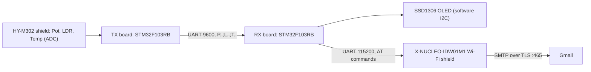

# STM32 Wi-Fi Sensor Mailer

Two-board STM32F103 project: one board reads analog sensors and streams the readings over UART, the other shows them on an OLED display and e-mails them through a Wi-Fi AT-command module (SMTP over TLS).

## How it works



- **Transmitter** ([`sensor_transmitter`](sensor_transmitter)) samples three ADC channels twice a second and sends one text frame per sample.
- **Receiver** ([`wifi_mail_receiver`](wifi_mail_receiver)) decodes the frames with a software UART (TIM1 input capture on PA8), shows the values on a 128x32 SSD1306 OLED and, once a minute, sends an e-mail with the latest readings via Gmail SMTP (`smtp.gmail.com:465`). The OLED shows `NO LINK` if no frame arrives for 3 s and a short error code if Wi-Fi or SMTP fails.

### Frame format

```
P<pot>;L<light>;T<temp>\r\n        e.g.  P12.3;L45.6;T23.4
```

Potentiometer and light are in percent of the ADC range, temperature is in degrees Celsius (linear 0..205 mapping of the 12-bit ADC value). Each value has exactly one decimal digit. UART settings: 9600 baud, 8N1.

## Hardware

- 2x STM32 Nucleo-F103RB (STM32F103RBT6, internal HSI clock)
- HY-M302 sensor shield with a potentiometer, a photoresistor (LDR) and an analog temperature sensor, on the transmitter board
- SSD1306 128x32 I2C OLED (address 0x3C), on the receiver board
- X-NUCLEO-IDW01M1 Wi-Fi expansion board (SPWF01SA module, `AT+S.*` command set) on the receiver board, connected to USART1

### Pinout

Transmitter:

| Pin | Function |
|-----|----------|
| PA0 | ADC1_IN0, potentiometer |
| PA1 | ADC1_IN1, light sensor |
| PA4 | ADC1_IN4, temperature sensor |
| PA9 | USART1 TX, data to the receiver |
| PA5 | LD2, heartbeat LED |

Receiver:

| Pin | Function |
|-----|----------|
| PA8 | LINK_RX, input from the transmitter PA9 (software UART, 9600 baud) |
| PA9 / PA10 | USART1 TX / RX to the X-NUCLEO-IDW01M1 (115200 baud) |
| PA11 / PA12 | Wi-Fi flow control line (the driver auto-detects which one is CTS) |
| PC12 | WIFI_RST, module reset |
| PB8 / PB9 | OLED SCL / SDA (software I2C) |
| PC0 / PC1 | Alternative OLED SCL / SDA (the driver tries PB8/PB9 first, then PC0/PC1) |

Connect the transmitter PA9 to the receiver PA8 and join the grounds of both boards.

## Build and flash

1. Install [STM32CubeIDE](https://www.st.com/en/development-tools/stm32cubeide.html).
2. `File > Open Projects from File System...` and import `sensor_transmitter` and `wifi_mail_receiver`.
3. Configure credentials for the receiver (see below).
4. Build each project (`Debug` configuration) and flash it to the matching board with the included `*.launch` debug configuration.

The `.ioc` files can be opened in STM32CubeMX to inspect or change the peripheral configuration. Custom code lives between the `USER CODE BEGIN/END` markers, so regeneration is safe.

## Configure Wi-Fi and e-mail

Credentials are not stored in the repository.

1. Copy `wifi_mail_receiver/Core/Inc/wifi_secrets.example.h` to `wifi_mail_receiver/Core/Inc/wifi_secrets.h`.
2. Fill in the Wi-Fi SSID and password, your Gmail address, the recipient address and a Gmail **App password**.
   - Enable 2-Step Verification for the Google account, then create an app password at <https://myaccount.google.com/apppasswords>. Your normal account password will not work.
3. `wifi_secrets.h` is listed in `.gitignore`; never commit it.

If the file is missing, the build stops with an explanatory `#error`. If the placeholder values are left in place, the receiver shows `NO CRED` on the OLED.

### Error codes on the OLED

| Text | Meaning |
|------|---------|
| `NO CRED` | placeholder credentials were not replaced |
| `NO AT` | Wi-Fi module does not answer AT commands |
| `ECHO` .. `SAVE`, `NO UP` | a configuration step or the Wi-Fi association failed |
| `SOCK`, `NO 220` | cannot open the TLS socket / no SMTP greeting |
| `EHLO`, `AUTH`, `USER`, `PASS` | SMTP handshake or login rejected |
| `FROM`, `RCPT`, `DATA`, `BODY` | the server refused the message |

## Repository layout

```
sensor_transmitter/     Transmitter project (ADC + UART)
wifi_mail_receiver/     Receiver project (software UART, OLED, Wi-Fi and SMTP client)
  Core/Src/wifi_mail.c    Wi-Fi AT driver and SMTP client
  Core/Src/ssd1306.c      Minimal SSD1306 driver with software I2C
  Core/Inc/wifi_secrets.example.h   Credentials template
```

## Known limitations

- The SMTP client is deliberately minimal: fixed `smtp.gmail.com:465`, `AUTH LOGIN`, plain-text body, no retries beyond a single repeat per command.
- The receiver blocks in the main loop while an e-mail is being sent, so OLED updates pause for that time.
- The software UART relies on a stable HSI-derived clock and short interrupt latency, so keep the baud rate at 9600.

## License

Project code is released under the [MIT License](LICENSE). The STM32 HAL and CMSIS code in the `Drivers/` folders belongs to STMicroelectronics and Arm and is covered by its own licenses.
